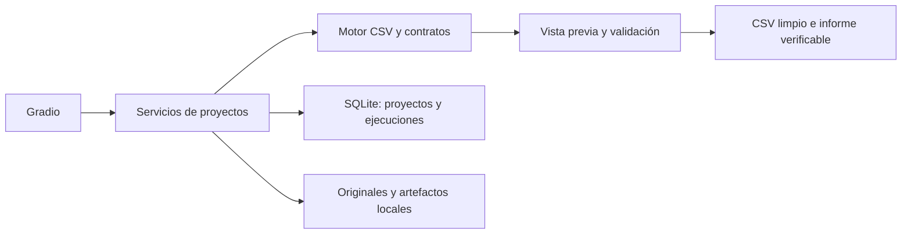
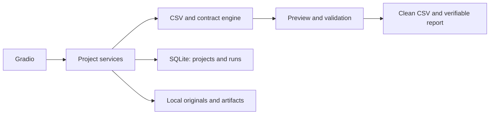
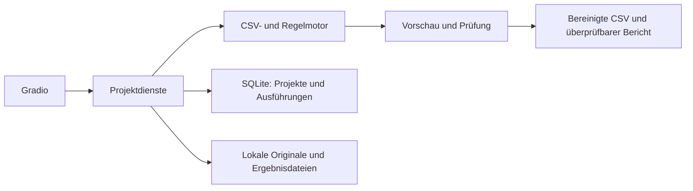

# Dato · CSV Data Quality Studio

[](https://github.com/GabrielDP97/estudio-calidad-datos-gradio/actions/workflows/verify.yml)

<a id="languages"></a>
**Documentación / Documentation / Dokumentation:** [Español](#espanol) · [English](#english) · [Deutsch](#deutsch)


<a id="espanol"></a>
## Español

Una aplicación con **Gradio, Python y SQLite** para diagnosticar CSV, preparar contratos de datos y guardar ejecuciones reproducibles. Funciona en tu ordenador, sin claves de API ni servicios de pago.

**Versión 1.2.0.** El análisis es determinista: no utiliza un modelo de IA ni inventa valores para corregir errores. Gradio aporta la interfaz y las conexiones entre controles y servicios Python.

### Inicio rápido

Requiere Python 3.10 o posterior. En PowerShell:

```powershell
git clone https://github.com/GabrielDP97/estudio-calidad-datos-gradio.git
cd estudio-calidad-datos-gradio
python -m venv .venv
.venv\Scripts\python.exe -m pip install -r requirements-lock.txt
.venv\Scripts\python.exe app.py
```

Abre **http://127.0.0.1:7860/**. Mantén la terminal abierta. También puedes usar `iniciar.cmd` después de instalar el entorno. Si el puerto está ocupado, ejecuta `app.py --port 7861`.

En Linux usa `python3 -m venv .venv` y `.venv/bin/python` en lugar de `.venv\Scripts\python.exe`. El repositorio es privado; para clonarlo necesitas una cuenta con acceso.

### Idiomas

El selector **Idioma / Language / Sprache**, situado arriba, permite elegir **Español**, **English** o **Deutsch**. Cambia los textos, controles, diagnósticos, incidencias y resultados sin reiniciar ni perder las reglas en edición. Cada sesión mantiene su propio idioma; al recargar empieza en español.

Los nombres de proyectos, archivos, columnas y valores del CSV se conservan. Los contratos JSON y los informes descargables mantienen su formato técnico estable para que el idioma no cambie las reglas, los archivos generados ni sus huellas. Las traducciones están incluidas en el código y no utilizan servicios externos.

### Demostración

1. Pulsa **Cargar ejemplo completo**. Crea un proyecto con dos CSV sintéticos: clientes y productos, y sus contratos.
2. En **Diagnóstico**, revisa columnas, ausentes, tipos sugeridos y las incidencias del contrato guardado. El original se puede descargar intacto.
3. En **Reglas y limpieza**, revisa el contrato y pulsa **Vista previa**. No se escribe una ejecución en el historial.
4. Abre **Comparación y resultados** para comparar los primeros 100 registros y revisar las incidencias posteriores.
5. Pulsa **Ejecutar y guardar estas reglas** desde Comparación (o **Ejecutar y guardar** desde Reglas y limpieza). En Comparación aparecen cinco descargas y en Historial una nueva ejecución.
6. Repite la ejecución con la misma entrada y contrato: el identificador cambia, pero la huella de salida debe coincidir.

El ejemplo de clientes tiene **8 filas**, produce **3 válidas y 5 excluidas**: incluye correos incorrectos, una fecha imposible, edades fuera de rango y un identificador repetido. No contiene datos de personas reales.

### Funciones

- Proyectos persistentes con hasta 10 CSV, detección de coma, punto y coma, tabulador y barra vertical; UTF-8 o Windows-1252.
- Perfil de columnas: ausentes, valores distintos, ejemplos y sugerencia de tipo. Las sugerencias son heurísticas y deben revisarse.
- Contratos de texto, entero, decimal, correo, fecha o booleano; valores obligatorios, rangos y claves únicas simples o compuestas.
- Limpieza por etapas: recortar espacios, rellenar ausentes con un valor explícito, sustituir valores exactos, cambiar mayúsculas/minúsculas y excluir duplicados.
- Formulario de reglas y editor JSON avanzado, importación/exportación de contratos y restauración del contrato sugerido.
- Vista previa sobre una copia; los originales son inmutables y su SHA-256 se comprueba al abrirlos.
- Historial en SQLite, contratos usados, métricas, incidencias por fila y columna y huellas SHA-256 de entrada, reglas y salida.
- Descargas de CSV limpio, filas excluidas, incidencias, informe JSON y reglas. Los informes completos incluyen todas las incidencias admitidas, no solo las primeras 100 que muestra la interfaz.

### Reglas y comportamiento

Cada vista previa y ejecución empieza **desde el original**, no desde una transformación anterior. No se acumulan cambios de forma accidental. Se aplican estas etapas en orden por celda:

1. Recortar espacios.
2. Rellenar valores que coincidan con `missing_values`.
3. Sustituir valores exactos mediante `replace`.
4. Cambiar a minúsculas o mayúsculas.
5. Identificar duplicados según el subconjunto elegido (vacío = fila completa).
6. Validar tipos, obligatoriedad, rangos y claves únicas.

Los duplicados conservan la **primera aparición**, incluso si esa primera fila tiene otro error. Las claves únicas no consideran los valores ausentes. La comparación es exacta tras las transformaciones seleccionadas. Una fila con varias incidencias se excluye una vez, aunque figure varias veces en el informe.

Las fechas admiten `%Y-%m-%d`, `%d/%m/%Y` y `%d-%m-%Y`, con formato estricto. Los decimales usan punto; una coma decimal debe sustituirse explícitamente en las reglas. Los booleanos admiten `true`, `false`, `1`, `0`, `sí`, `si` y `no`. La validación de correo comprueba el formato básico, no la existencia del buzón.

Ejemplo reducido de contrato:

```json
{
  "version": 1,
  "columns": {
    "email": {"type": "email", "required": true, "trim": true, "lowercase": true},
    "edad": {"type": "integer", "min": 18, "max": 120}
  },
  "unique": [["email"]],
  "drop_duplicates": false,
  "duplicate_subset": [],
  "missing_values": ["", "NULL", "N/A"]
}
```

Solo se aceptan opciones declarativas conocidas. No se utiliza `eval`, código del usuario ni expresiones regulares arbitrarias. Las sustituciones avanzadas tienen la forma `"replace": {"antiguo": "nuevo"}` dentro de una columna. Guarda o ejecuta para conservar un contrato editado; importar y previsualizar no lo guardan automáticamente.

### Resultados y reproducibilidad

Cada ejecución guarda:

| Archivo | Contenido |
| --- | --- |
| `limpio.csv` | Filas transformadas que superan el contrato |
| `rechazadas.csv` | Filas excluidas y columna inicial `__fila_origen` |
| `incidencias.csv` | Registro CSV, columna, valor y motivo |
| `informe.json` | Métricas, perfil antes/después, incidencias antes/después, contrato y huellas |
| `reglas.json` | Contrato normalizado utilizado |

Las filas se numeran como **registros CSV**, con cabecera = 1. Un campo entrecomillado puede abarcar varias líneas físicas. Se ignoran líneas vacías. Se conservan ceros iniciales porque las celdas se manejan como texto.

La exportación usa UTF-8 con BOM, coma y saltos de línea LF. Para proteger la apertura en hojas de cálculo se añade un apóstrofo a textos que puedan interpretarse como fórmulas. Esa protección puede hacer que la representación exportada difiera de la vista previa; no convierte números negativos válidos en texto protegido.

Las huellas SHA-256 identifican los bytes de entrada, el contrato JSON normalizado y el CSV limpio exportado. La misma entrada y reglas, con la misma versión del motor, producen la misma salida. El informe incluye metadatos variables como fecha e identificador; no se espera que el archivo JSON completo sea idéntico entre ejecuciones.

### Arquitectura



- `app.py`: arranque en `127.0.0.1`, sin enlaces públicos de Gradio.
- `quality_studio/engine.py`: dominio sin dependencia de Gradio; lectura, contratos, perfiles, transformaciones y exportación.
- `quality_studio/store.py`: SQLite, originales, publicación de artefactos completos y auditoría.
- `quality_studio/ui.py`: interfaz, formulario de reglas y conexión con los servicios.
- `quality_studio/i18n.py` y `native_locale.js`: traducciones locales y controles de idioma.
- `examples/`: datos sintéticos y contratos de demostración.
- `tests/`: pruebas del motor, persistencia y flujo HTTP real de Gradio.

### Límites

| Recurso | Límite |
| --- | --- |
| Tamaño de un CSV | 100 MiB |
| Filas por CSV | 500 000 |
| Columnas | 100 |
| Celdas | 5 millones |
| Incidencias en una ejecución | 20 000; si se superan, se pide dividir el CSV o revisar reglas |
| CSV por proyecto | 10 distintos; el mismo contenido no se duplica |
| Contrato JSON | 100 KB |
| Vista previa | Primeros 100 registros; el motor analiza el conjunto completo dentro de los límites |
| Historial visible | Últimas 100 ejecuciones por proyecto; las anteriores permanecen en disco |

Verificación manual: un CSV sintético de 104 856 013 bytes (casi 100 MiB), con 257 000 filas, se ha subido desde el navegador, procesado y exportado completo; se ha comprobado el número de filas y el SHA-256 de la salida.

Los archivos se procesan en memoria. Los CSV grandes tardan más y pueden consumir varios GB de RAM; la cantidad depende de las filas, columnas y longitud de los valores. El tamaño permitido no garantiza que cualquier estructura quepa en los otros límites.

El límite adicional de un campo CSV es un millón de caracteres. No se procesan XLSX, PDF, bases de datos remotas ni múltiples hojas. No se hacen uniones entre CSV ni se entrenan modelos de IA.

### Privacidad y persistencia

La aplicación escucha únicamente en el ordenador local y no activa `share=True`. Desactiva la analítica de Gradio y la telemetría de Hugging Face. Instalar dependencias requiere internet; procesar CSV no requiere servicios externos.

Los datos **se guardan en disco** dentro de `.private/data`: SQLite, copias originales, contratos y exportaciones. Gradio mantiene también una caché local de subidas y descargas en `.private/gradio-cache`. No se eliminan al cerrar: permiten reabrir proyectos e historial. Estas carpetas están excluidas de Git. Los datos no están cifrados por la aplicación; se protegen con los permisos de tu usuario del sistema.

Para copiar o respaldar un proyecto, detén el servidor y conserva la carpeta `.private/data` completa, incluyendo SQLite y sus directorios de archivos. Para empezar desde cero, cierra el servidor y mueve esa carpeta a una copia de respaldo. No publiques este servidor como aplicación multiusuario sin añadir autenticación, aislamiento y gestión de almacenamiento.

### Pruebas

```powershell
.venv\Scripts\python.exe -m unittest discover -s tests -v
.venv\Scripts\python.exe -m pip check
```

La suite incluye **40 pruebas**, entre ellas el flujo HTTP real de Gradio. GitHub Actions instala las dependencias fijadas y ejecuta las pruebas al actualizar `main` o abrir una pull request. Se comprueban errores CSV, codificaciones, límites, validación de reglas, transformaciones, exportación segura, reproducibilidad, conservación de originales, reapertura del historial y fallos de escritura. La integración de Gradio usa un servidor local temporal y datos sintéticos.

### Problemas frecuentes

- **No abre la web:** mantén la terminal abierta y usa el puerto indicado en el arranque.
- **No lee acentos:** comprueba UTF-8 o selecciona Windows-1252 antes de incorporar el archivo.
- **Detecta columnas incorrectas:** selecciona explícitamente el separador en Opciones de lectura.
- **Las reglas no cambian el resultado:** pulsa Aplicar regla al JSON y después Vista previa o Ejecutar y guardar.
- **No aparecen descargas tras previsualizar:** la vista previa no crea una ejecución; pulsa Ejecutar y guardar.
- **Todas las filas se excluyen:** revisa los tipos sugeridos, los formatos de fecha y los valores ausentes del contrato.

Consulta [CHANGELOG.md](CHANGELOG.md) y [CONTRIBUTING.md](CONTRIBUTING.md). Gradio es de código abierto, con licencia Apache-2.0; consulta su [repositorio oficial](https://github.com/gradio-app/gradio).

[Volver a la selección de idioma](#languages)

<a id="english"></a>
## English

A local application built with **Gradio, Python and SQLite** to diagnose CSV files, define data contracts and save reproducible cleaning runs. It runs on your computer without API keys or paid services.

**Version 1.2.0.** Analysis is deterministic: no AI model is used and missing or incorrect values are not invented. Gradio provides the interface and connects controls to Python services.

### Quick start

Requires Python 3.10 or later. In PowerShell:

```powershell
git clone https://github.com/GabrielDP97/estudio-calidad-datos-gradio.git
cd estudio-calidad-datos-gradio
python -m venv .venv
.venv\Scripts\python.exe -m pip install -r requirements-lock.txt
.venv\Scripts\python.exe app.py
```

Open [http://127.0.0.1:7860/](http://127.0.0.1:7860/) and keep the terminal open. After installing the environment, you can also use `iniciar.cmd`. If the port is busy, run `app.py --port 7861`.

On Linux, use `python3 -m venv .venv` and `.venv/bin/python` instead of `.venv\Scripts\python.exe`. This repository is private; cloning requires an account with access.

### Languages

The **Idioma / Language / Sprache** selector at the top switches between **Español**, **English** and **Deutsch**. It changes interface text, controls, diagnostics, issues and results without restarting or losing rules being edited. Each session has its own language; reloading starts in Spanish.

Project names, filenames, column names and CSV values stay unchanged. JSON contracts and downloadable reports retain their stable technical format, so switching languages does not alter rules, generated files or hashes. All translations are included locally; no external translation service is used.

### Demo

1. Choose **English** and click **Load full example**. This creates a project containing two synthetic CSV files, customers and products, with prepared contracts.
2. In **Diagnostics**, inspect columns, missing values, suggested types and issues against the saved contract. Download the unchanged original if needed.
3. In **Rules and cleaning**, review the contract and click **Preview**. This does not create a saved run.
4. Open **Comparison and results** to compare the first 100 records and inspect issues after cleaning.
5. Click **Run and save these rules** in Comparison, or **Run and save** in Rules and cleaning. Comparison shows five downloads and History gains a new run.
6. Repeat with the same input and contract: the run ID changes, but the output hash should match.

The customer example has **8 rows**, producing **3 valid and 5 excluded rows**. It includes invalid email addresses, an impossible date, out-of-range ages and a repeated identifier. It contains no real personal data. Example file and column names remain in their original Spanish.

### Features

- Persistent projects with up to 10 CSV files; automatic detection of comma, semicolon, tab and pipe delimiters; UTF-8 or Windows-1252 encoding.
- Column profiles with missing values, distinct values, examples and suggested types. Suggestions are heuristic and should be reviewed.
- Text, integer, decimal, email, date and boolean contracts; required values, ranges and simple or composite unique keys.
- Ordered cleaning steps: trim whitespace, explicitly fill missing values, replace exact values, change letter case and exclude duplicates.
- Rule form, advanced JSON editor, contract import/export and restoration of the suggested contract.
- Preview on a copy; originals are immutable and their SHA-256 is checked when opened.
- SQLite history, contracts used, metrics, row/column issues and SHA-256 hashes of inputs, rules and outputs.
- Downloads of clean CSV, excluded rows, issues, JSON report and rules. Full reports contain all accepted issues, beyond the first 100 shown in the interface.

### Rules and behavior

Every preview and run starts **from the original**, so changes do not accumulate from earlier transformations. Processing follows this order:

1. Trim whitespace.
2. Fill values matching `missing_values`.
3. Replace exact values using `replace`.
4. Convert to lowercase or uppercase.
5. Identify duplicates using the chosen subset of columns; an empty subset means the entire row.
6. Validate types, required values, ranges and unique keys.

Duplicates keep the **first occurrence**, even when that first row has another error. Unique keys ignore missing values. Comparisons are exact after the selected transformations. A row with several issues is excluded only once, although it may appear several times in the issue report.

Dates strictly follow `%Y-%m-%d`, `%d/%m/%Y` or `%d-%m-%Y`. Decimals use a dot; a decimal comma must be explicitly replaced in the rules. Boolean values accept `true`, `false`, `1`, `0`, `sí`, `si` and `no`, regardless of the interface language. Email validation checks basic syntax, not whether a mailbox exists.

Minimal contract example; `edad` is the original age column name:

```json
{
  "version": 1,
  "columns": {
    "email": {"type": "email", "required": true, "trim": true, "lowercase": true},
    "edad": {"type": "integer", "min": 18, "max": 120}
  },
  "unique": [["email"]],
  "drop_duplicates": false,
  "duplicate_subset": [],
  "missing_values": ["", "NULL", "N/A"]
}
```

Only recognized declarative options are accepted. There is no `eval`, user-supplied code or arbitrary regular expression execution. Advanced replacements use `"replace": {"old": "new"}` inside a column definition. Save or run to persist edited rules; importing and previewing do not save them automatically.

### Results and reproducibility

Each saved run produces these files. Filenames and technical keys remain unchanged in every interface language:

| File | Contents |
| --- | --- |
| `limpio.csv` | Transformed rows passing the contract |
| `rechazadas.csv` | Excluded rows with an initial `__fila_origen` source-row column |
| `incidencias.csv` | CSV record, column, value and reason |
| `informe.json` | Metrics, before/after profiles and issues, contract and hashes |
| `reglas.json` | Normalized contract used for the run |

Row numbers refer to **CSV records**, with header = 1. A quoted field may span several physical lines. Empty lines are ignored. Leading zeroes are preserved because cells are handled as text.

Exports use UTF-8 with BOM, comma delimiters and LF line endings. Text that could be interpreted as a spreadsheet formula is prefixed with an apostrophe. This protection may make exported values differ from the preview; valid negative numbers are not turned into protected text.

SHA-256 hashes identify input bytes, the normalized JSON contract and exported clean CSV. The same input and rules with the same engine version produce the same output. Reports include changing metadata such as timestamps and run IDs, so the full JSON report is not expected to be byte-identical between runs.

### Architecture



- `app.py`: starts on `127.0.0.1`, without public Gradio links.
- `quality_studio/engine.py`: Gradio-independent parsing, contracts, profiling, transformations and exports.
- `quality_studio/store.py`: SQLite, originals, publication of complete artifacts and audit records.
- `quality_studio/ui.py`: interface, rule form and service connections.
- `quality_studio/i18n.py` and `native_locale.js`: local translations and language controls.
- `examples/`: synthetic datasets and demo contracts.
- `tests/`: engine, persistence and real Gradio HTTP integration tests.

### Limits

| Resource | Limit |
| --- | --- |
| CSV file size | 100 MiB |
| Rows per CSV | 500,000 |
| Columns | 100 |
| Cells | 5 million |
| Issues per run | 20,000; exceeding this requires splitting the CSV or reviewing rules |
| CSV files per project | 10 distinct files; identical content is not duplicated |
| JSON contract | 100 KB |
| Preview | First 100 records; the engine processes the entire accepted dataset |
| Visible history | Latest 100 runs per project; older runs remain on disk |

Manual verification: a synthetic CSV of 104,856,013 bytes, almost 100 MiB, with 257,000 rows was uploaded through the browser, processed and exported in full. The output row count and SHA-256 were independently checked.

Files are processed in memory. Large CSV files take longer and may use several GB of RAM, depending on row count, column count and value length. Meeting the size limit does not guarantee meeting the other limits.

An individual CSV field is additionally limited to one million characters. XLSX, PDF, remote databases and multi-sheet documents are not supported. The app does not join CSV files or train AI models.

### Privacy and persistence

The app listens only on the local computer and does not enable `share=True`. Gradio analytics and Hugging Face telemetry are disabled. Installing dependencies needs internet access; CSV processing does not require external services.

Data **is saved to disk** in `.private/data`: SQLite, originals, contracts and exports. Gradio also keeps a local upload/download cache in `.private/gradio-cache`. These directories remain after closing the app so projects and history can be reopened; they are excluded from Git. The app does not encrypt them; your operating-system account permissions protect access.

To back up or copy projects, stop the server and preserve the entire `.private/data` directory, including SQLite and file directories. To start fresh, stop the server and move that directory to a backup location. Do not publish this server as a multiuser app without adding authentication, isolation and storage management.

### Tests

```powershell
.venv\Scripts\python.exe -m unittest discover -s tests -v
.venv\Scripts\python.exe -m pip check
```

The suite contains **40 tests**, including real Gradio HTTP integration. GitHub Actions installs pinned dependencies and runs checks on updates to `main` and pull requests. Coverage includes CSV errors, encodings, resource limits, contract validation, transformations, safe export, reproducibility, original preservation, reopening history, write failures, translations and session isolation. Integration tests use a temporary local server and synthetic data.

### Troubleshooting

- **The page does not open:** keep the terminal open and use the port printed at startup.
- **Accented characters are incorrect:** check UTF-8 or select Windows-1252 before adding the file.
- **Columns are detected incorrectly:** explicitly choose the delimiter in Reading options.
- **Rules do not change results:** click Apply rule to JSON, then Preview or Run and save.
- **No downloads after preview:** preview does not save a run; click Run and save.
- **Every row is excluded:** review suggested types, date formats and missing-value tokens in the contract.

See [CHANGELOG.md](CHANGELOG.md) and [CONTRIBUTING.md](CONTRIBUTING.md), currently in Spanish. Gradio is open source under Apache-2.0; see its [official repository](https://github.com/gradio-app/gradio).

[Back to language selection](#languages)

<a id="deutsch"></a>
## Deutsch

Eine lokale Anwendung mit **Gradio, Python und SQLite**, um CSV-Dateien zu prüfen, Datenregeln zu definieren und reproduzierbare Bereinigungsläufe zu speichern. Sie läuft auf deinem Computer, ohne API-Schlüssel oder kostenpflichtige Dienste.

**Version 1.2.0.** Die Analyse ist deterministisch: Es wird kein KI-Modell verwendet, und fehlende oder fehlerhafte Werte werden nicht erfunden. Gradio stellt die Oberfläche bereit und verbindet die Bedienelemente mit den Python-Diensten.

### Schnellstart

Voraussetzung: Python 3.10 oder neuer. In PowerShell:

```powershell
git clone https://github.com/GabrielDP97/estudio-calidad-datos-gradio.git
cd estudio-calidad-datos-gradio
python -m venv .venv
.venv\Scripts\python.exe -m pip install -r requirements-lock.txt
.venv\Scripts\python.exe app.py
```

Öffne [http://127.0.0.1:7860/](http://127.0.0.1:7860/) und lasse das Terminal geöffnet. Nach der Einrichtung kannst du auch `iniciar.cmd` verwenden. Ist der Port belegt, starte `app.py --port 7861`.

Unter Linux verwendest du `python3 -m venv .venv` und `.venv/bin/python` statt `.venv\Scripts\python.exe`. Das Repository ist privat; zum Klonen benötigst du ein Konto mit Zugriffsberechtigung.

### Sprachen

Über **Idioma / Language / Sprache** oben in der Anwendung wählst du **Español**, **English** oder **Deutsch**. Texte, Bedienelemente, Diagnosen, Probleme und Ergebnisse wechseln ohne Neustart und ohne Verlust der gerade bearbeiteten Regeln. Jede Sitzung hat ihre eigene Sprache; nach dem Neuladen beginnt die Oberfläche auf Spanisch.

Projekt-, Datei- und Spaltennamen sowie CSV-Werte bleiben unverändert. JSON-Regelwerke und herunterladbare Berichte behalten ihr stabiles technisches Format, damit ein Sprachwechsel weder Regeln noch erzeugte Dateien oder Prüfsummen verändert. Die Übersetzungen sind lokal enthalten; externe Übersetzungsdienste werden nicht verwendet.

### Beispielablauf

1. Wähle **Deutsch** und klicke auf **Vollständiges Beispiel laden**. Dadurch entsteht ein Projekt mit zwei synthetischen CSV-Dateien für Kunden und Produkte sowie vorbereiteten Regelwerken.
2. Prüfe unter **Diagnose** die Spalten, fehlende Werte, vorgeschlagene Typen und Probleme des gespeicherten Regelwerks. Das unveränderte Original lässt sich herunterladen.
3. Prüfe unter **Regeln und Bereinigung** das Regelwerk und klicke auf **Vorschau**. Dadurch wird noch keine Ausführung gespeichert.
4. Öffne **Vergleich und Ergebnisse**, um die ersten 100 Datensätze zu vergleichen und die Probleme nach der Bereinigung anzusehen.
5. Klicke im Vergleich auf **Diese Regeln ausführen und speichern**, oder unter Regeln und Bereinigung auf **Ausführen und speichern**. Im Vergleich erscheinen fünf Downloads, im Verlauf eine neue Ausführung.
6. Wiederhole die Ausführung mit derselben Eingabe und denselben Regeln: Die Ausführungs-ID ändert sich, die Ausgabeprüfsumme sollte gleich bleiben.

Das Kundenbeispiel enthält **8 Zeilen** und ergibt **3 gültige und 5 ausgeschlossene Zeilen**. Es enthält ungültige E-Mail-Adressen, ein unmögliches Datum, Alterswerte außerhalb des Bereichs und eine doppelte Kennung. Es werden keine echten personenbezogenen Daten verwendet. Die Datei- und Spaltennamen der Beispiele bleiben auf Spanisch.

### Funktionen

- Dauerhaft gespeicherte Projekte mit bis zu 10 CSV-Dateien; automatische Erkennung von Komma, Semikolon, Tabulator und senkrechtem Strich; UTF-8 oder Windows-1252.
- Spaltenprofile mit fehlenden und unterschiedlichen Werten, Beispielen und Typvorschlägen. Die Vorschläge sind heuristisch und müssen geprüft werden.
- Regeln für Text, Ganzzahlen, Dezimalzahlen, E-Mail, Datum und Wahrheitswerte; Pflichtwerte, Wertebereiche sowie einfache und zusammengesetzte eindeutige Schlüssel.
- Geordnete Bereinigungsschritte: Leerzeichen entfernen, fehlende Werte ausdrücklich ersetzen, exakte Werte austauschen, Groß-/Kleinschreibung ändern und Duplikate ausschließen.
- Regelformular, erweiterter JSON-Editor, Import/Export und Wiederherstellung des vorgeschlagenen Regelwerks.
- Vorschau auf einer Kopie; Originale bleiben unverändert, und ihr SHA-256 wird beim Öffnen überprüft.
- SQLite-Verlauf, verwendete Regeln, Kennzahlen, Probleme nach Zeile und Spalte sowie SHA-256-Prüfsummen von Eingaben, Regeln und Ausgaben.
- Downloads der bereinigten CSV-Datei, ausgeschlossener Zeilen, Probleme, des JSON-Berichts und der Regeln. Vollständige Berichte enthalten alle zulässigen Probleme, nicht nur die ersten 100 der Oberfläche.

### Regeln und Verhalten

Jede Vorschau und Ausführung beginnt **beim Original**, nicht bei einer vorherigen Bearbeitung. Änderungen sammeln sich dadurch nicht versehentlich an. Die Verarbeitung erfolgt in dieser Reihenfolge:

1. Leerzeichen entfernen.
2. Werte auffüllen, die `missing_values` entsprechen.
3. Exakte Werte mit `replace` ersetzen.
4. In Klein- oder Großbuchstaben umwandeln.
5. Duplikate anhand der gewählten Spalten erkennen; eine leere Auswahl bedeutet die gesamte Zeile.
6. Typen, Pflichtwerte, Bereiche und eindeutige Schlüssel prüfen.

Bei Duplikaten bleibt das **erste Vorkommen** erhalten, auch wenn diese erste Zeile einen anderen Fehler enthält. Eindeutige Schlüssel berücksichtigen keine fehlenden Werte. Vergleiche erfolgen nach den gewählten Bearbeitungsschritten exakt. Eine Zeile mit mehreren Problemen wird nur einmal ausgeschlossen, kann im Problembericht jedoch mehrfach erscheinen.

Datumswerte müssen genau `%Y-%m-%d`, `%d/%m/%Y` oder `%d-%m-%Y` entsprechen. Dezimalzahlen verwenden einen Punkt; ein Dezimalkomma muss durch eine ausdrückliche Regel ersetzt werden. Wahrheitswerte akzeptieren unabhängig von der Oberflächensprache `true`, `false`, `1`, `0`, `sí`, `si` und `no`. Die E-Mail-Prüfung kontrolliert das grundlegende Format, nicht die Existenz eines Postfachs.

Verkürztes Regelwerk; `edad` ist der ursprüngliche Name der Altersspalte:

```json
{
  "version": 1,
  "columns": {
    "email": {"type": "email", "required": true, "trim": true, "lowercase": true},
    "edad": {"type": "integer", "min": 18, "max": 120}
  },
  "unique": [["email"]],
  "drop_duplicates": false,
  "duplicate_subset": [],
  "missing_values": ["", "NULL", "N/A"]
}
```

Nur bekannte deklarative Optionen sind zulässig. Es werden weder `eval` noch Benutzercode oder beliebige reguläre Ausdrücke ausgeführt. Erweiterte Ersetzungen stehen als `"replace": {"alt": "neu"}` innerhalb einer Spaltendefinition. Bearbeitete Regeln bleiben erst nach Speichern oder Ausführen erhalten; Import und Vorschau speichern sie nicht automatisch.

### Ergebnisse und Reproduzierbarkeit

Jede gespeicherte Ausführung erzeugt die folgenden Dateien. Dateinamen und technische Schlüssel bleiben in allen Oberflächensprachen gleich:

| Datei | Inhalt |
| --- | --- |
| `limpio.csv` | Bearbeitete Zeilen, die das Regelwerk erfüllen |
| `rechazadas.csv` | Ausgeschlossene Zeilen mit führender Quellzeilenspalte `__fila_origen` |
| `incidencias.csv` | CSV-Datensatz, Spalte, Wert und Grund |
| `informe.json` | Kennzahlen, Profile und Probleme vorher/nachher, Regelwerk und Prüfsummen |
| `reglas.json` | Verwendetes normalisiertes Regelwerk |

Zeilennummern bezeichnen **CSV-Datensätze**, wobei die Kopfzeile die Nummer 1 hat. Ein Feld in Anführungszeichen kann mehrere physische Zeilen umfassen. Leere Zeilen werden ignoriert. Führende Nullen bleiben erhalten, weil Zellen als Text verarbeitet werden.

Der Export verwendet UTF-8 mit BOM, Kommas als Trennzeichen und LF-Zeilenumbrüche. Texte, die als Tabellenkalkulationsformeln interpretiert werden könnten, erhalten ein vorangestelltes Apostroph. Deshalb kann die exportierte Darstellung von der Vorschau abweichen; gültige negative Zahlen werden nicht in geschützten Text umgewandelt.

SHA-256-Prüfsummen kennzeichnen die Eingabebytes, das normalisierte JSON-Regelwerk und die exportierte bereinigte CSV-Datei. Dieselbe Eingabe und dieselben Regeln ergeben mit derselben Motorversion dieselbe Ausgabe. Berichte enthalten veränderliche Metadaten wie Datum und Ausführungs-ID; die vollständige JSON-Datei muss deshalb zwischen Ausführungen nicht bytegleich sein.

### Architektur



- `app.py`: startet auf `127.0.0.1`, ohne öffentliche Gradio-Links.
- `quality_studio/engine.py`: von Gradio unabhängiges Einlesen, Regeln, Profile, Bearbeitung und Export.
- `quality_studio/store.py`: SQLite, Originale, Veröffentlichung vollständiger Ergebnisdateien und Prüfprotokolle.
- `quality_studio/ui.py`: Oberfläche, Regelformular und Verbindung zu den Diensten.
- `quality_studio/i18n.py` und `native_locale.js`: lokale Übersetzungen und Sprachsteuerung.
- `examples/`: synthetische Daten und Beispielregelwerke.
- `tests/`: Tests für Motor, Speicherung und echte Gradio-HTTP-Abläufe.

### Grenzen

| Ressource | Grenze |
| --- | --- |
| Größe einer CSV-Datei | 100 MiB |
| Zeilen pro CSV | 500.000 |
| Spalten | 100 |
| Zellen | 5 Millionen |
| Probleme pro Ausführung | 20.000; darüber muss die CSV-Datei aufgeteilt oder das Regelwerk geprüft werden |
| CSV-Dateien pro Projekt | 10 unterschiedliche Dateien; identischer Inhalt wird nicht dupliziert |
| JSON-Regelwerk | 100 KB |
| Vorschau | Erste 100 Datensätze; der Motor verarbeitet den gesamten zulässigen Datensatz |
| Sichtbarer Verlauf | Letzte 100 Ausführungen pro Projekt; ältere bleiben auf der Festplatte |

Manuell überprüft: Eine synthetische CSV-Datei mit 104.856.013 Bytes, fast 100 MiB, und 257.000 Zeilen wurde im Browser hochgeladen, verarbeitet und vollständig exportiert. Zeilenanzahl und SHA-256 der Ausgabe wurden unabhängig überprüft.

Dateien werden im Arbeitsspeicher verarbeitet. Große CSV-Dateien benötigen mehr Zeit und können mehrere GB RAM belegen; dies hängt von Zeilenanzahl, Spaltenanzahl und Wertlänge ab. Die Einhaltung der Dateigröße garantiert nicht die Einhaltung der übrigen Grenzen.

Ein einzelnes CSV-Feld darf zusätzlich höchstens eine Million Zeichen enthalten. XLSX, PDF, entfernte Datenbanken und Dokumente mit mehreren Tabellenblättern werden nicht verarbeitet. CSV-Dateien werden nicht zusammengeführt, und es werden keine KI-Modelle trainiert.

### Datenschutz und Speicherung

Die Anwendung ist nur auf dem lokalen Computer erreichbar und aktiviert kein `share=True`. Gradio-Analytik und Hugging-Face-Telemetrie sind deaktiviert. Die Installation der Abhängigkeiten benötigt Internetzugang; die CSV-Verarbeitung benötigt keine externen Dienste.

Daten **werden auf der Festplatte gespeichert**, unter `.private/data`: SQLite, Originalkopien, Regelwerke und Exporte. Gradio hält zusätzlich einen lokalen Upload-/Download-Cache in `.private/gradio-cache`. Diese Verzeichnisse bleiben nach dem Schließen erhalten, damit Projekte und Verlauf erneut geöffnet werden können; Git schließt sie aus. Die Anwendung verschlüsselt diese Daten nicht. Der Zugriff wird durch die Berechtigungen deines Betriebssystemkontos geschützt.

Zum Sichern oder Kopieren von Projekten hältst du den Server an und kopierst den vollständigen Ordner `.private/data`, einschließlich SQLite und aller Dateiverzeichnisse. Für einen Neustart ohne Daten hältst du den Server an und verschiebst diesen Ordner an einen Sicherungsort. Veröffentliche den Server nicht als Mehrbenutzeranwendung, ohne Authentifizierung, Isolation und Speicherverwaltung hinzuzufügen.

### Tests

```powershell
.venv\Scripts\python.exe -m unittest discover -s tests -v
.venv\Scripts\python.exe -m pip check
```

Die Testsuite enthält **40 Tests**, einschließlich echter Gradio-HTTP-Integration. GitHub Actions installiert die festgelegten Abhängigkeiten und prüft Aktualisierungen von `main` sowie Pull Requests. Geprüft werden CSV-Fehler, Zeichenkodierungen, Grenzen, Regeln, Bearbeitung, sicherer Export, Reproduzierbarkeit, unveränderte Originale, erneutes Öffnen des Verlaufs, Schreibfehler, Übersetzungen und Sitzungstrennung. Integrationstests verwenden einen temporären lokalen Server und synthetische Daten.

### Häufige Probleme

- **Die Seite öffnet sich nicht:** Lasse das Terminal geöffnet und verwende den beim Start angezeigten Port.
- **Umlaute oder Akzente sind falsch:** Prüfe UTF-8 oder wähle vor dem Hinzufügen Windows-1252.
- **Spalten werden falsch erkannt:** Wähle das Trennzeichen ausdrücklich unter Importoptionen.
- **Regeln ändern das Ergebnis nicht:** Klicke auf Regel in JSON übernehmen und anschließend auf Vorschau oder Ausführen und speichern.
- **Nach der Vorschau fehlen Downloads:** Eine Vorschau speichert keine Ausführung; klicke auf Ausführen und speichern.
- **Alle Zeilen werden ausgeschlossen:** Prüfe vorgeschlagene Typen, Datumsformate und die Platzhalter für fehlende Werte im Regelwerk.

Siehe [CHANGELOG.md](CHANGELOG.md) und [CONTRIBUTING.md](CONTRIBUTING.md), derzeit auf Spanisch. Gradio ist Open Source unter Apache-2.0; siehe das [offizielle Repository](https://github.com/gradio-app/gradio).

[Zurück zur Sprachauswahl](#languages)
