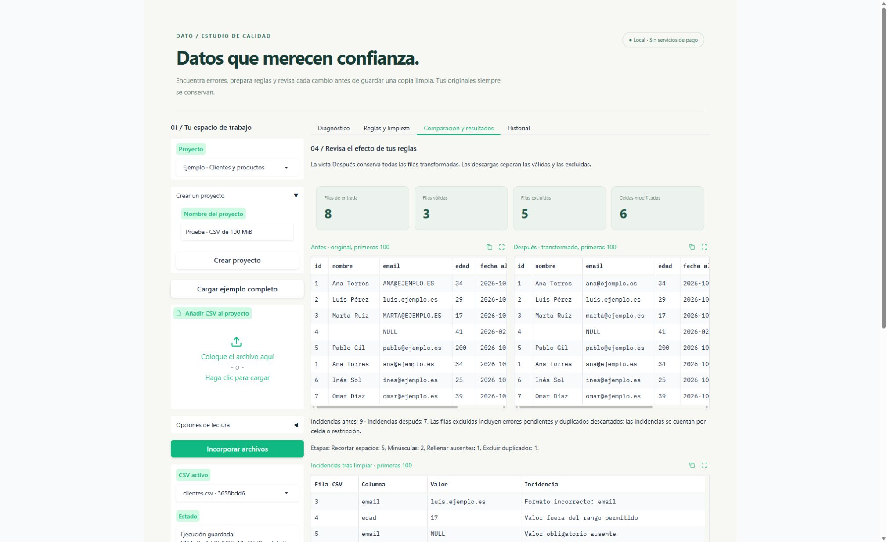
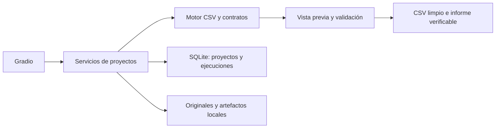

# Dato · Estudio local de calidad de datos

[](https://github.com/GabrielDP97/estudio-calidad-datos-gradio/actions/workflows/verify.yml)

Una aplicación con **Gradio, Python y SQLite** para diagnosticar CSV, preparar contratos de datos y guardar ejecuciones reproducibles. Funciona en tu ordenador, sin claves de API ni servicios de pago.

**Versión 1.2.0.** El análisis es determinista: no utiliza un modelo de IA ni inventa valores para corregir errores. Gradio aporta la interfaz y las conexiones entre controles y servicios Python.



## Inicio rápido

Requiere Python 3.10 o posterior. En PowerShell:

```powershell
git clone https://github.com/GabrielDP97/estudio-calidad-datos-gradio.git
cd estudio-calidad-datos-gradio
python -m venv .venv
.venv\Scripts\python.exe -m pip install -r requirements-lock.txt
.venv\Scripts\python.exe app.py
```

Abre **http://127.0.0.1:7860/**. Mantén la terminal abierta. También puedes usar `iniciar.cmd` después de instalar el entorno. Si el puerto está ocupado, ejecuta `app.py --port 7861`.

En Linux usa `python3 -m venv .venv` y `.venv/bin/python` en lugar de `.venv\Scripts\python.exe`. El repositorio es privado; para clonarlo necesitas una cuenta con acceso.

## Idiomas

El selector **Idioma / Language / Sprache**, situado arriba, permite elegir **Español**, **English** o **Deutsch**. Cambia los textos, controles, diagnósticos, incidencias y resultados sin reiniciar ni perder las reglas en edición. Cada sesión mantiene su propio idioma; al recargar empieza en español.

Los nombres de proyectos, archivos, columnas y valores del CSV se conservan. Los contratos JSON y los informes descargables mantienen su formato técnico estable para que el idioma no cambie las reglas, los archivos generados ni sus huellas. Las traducciones están incluidas en el código y no utilizan servicios externos.

## Demostración

1. Pulsa **Cargar ejemplo completo**. Crea un proyecto con dos CSV sintéticos: clientes y productos, y sus contratos.
2. En **Diagnóstico**, revisa columnas, ausentes, tipos sugeridos y las incidencias del contrato guardado. El original se puede descargar intacto.
3. En **Reglas y limpieza**, revisa el contrato y pulsa **Vista previa**. No se escribe una ejecución en el historial.
4. Abre **Comparación y resultados** para comparar los primeros 100 registros y revisar las incidencias posteriores.
5. Pulsa **Ejecutar y guardar estas reglas** desde Comparación (o **Ejecutar y guardar** desde Reglas y limpieza). En Comparación aparecen cinco descargas y en Historial una nueva ejecución.
6. Repite la ejecución con la misma entrada y contrato: el identificador cambia, pero la huella de salida debe coincidir.

El ejemplo de clientes tiene **8 filas**, produce **3 válidas y 5 excluidas**: incluye correos incorrectos, una fecha imposible, edades fuera de rango y un identificador repetido. No contiene datos de personas reales.

## Funciones

- Proyectos persistentes con hasta 10 CSV, detección de coma, punto y coma, tabulador y barra vertical; UTF-8 o Windows-1252.
- Perfil de columnas: ausentes, valores distintos, ejemplos y sugerencia de tipo. Las sugerencias son heurísticas y deben revisarse.
- Contratos de texto, entero, decimal, correo, fecha o booleano; valores obligatorios, rangos y claves únicas simples o compuestas.
- Limpieza por etapas: recortar espacios, rellenar ausentes con un valor explícito, sustituir valores exactos, cambiar mayúsculas/minúsculas y excluir duplicados.
- Formulario de reglas y editor JSON avanzado, importación/exportación de contratos y restauración del contrato sugerido.
- Vista previa sobre una copia; los originales son inmutables y su SHA-256 se comprueba al abrirlos.
- Historial en SQLite, contratos usados, métricas, incidencias por fila y columna y huellas SHA-256 de entrada, reglas y salida.
- Descargas de CSV limpio, filas excluidas, incidencias, informe JSON y reglas. Los informes completos incluyen todas las incidencias admitidas, no solo las primeras 100 que muestra la interfaz.

## Reglas y comportamiento

Cada vista previa y ejecución empieza **desde el original**, no desde una transformación anterior. No se acumulan cambios de forma accidental. Se aplican estas etapas en orden por celda:

1. Recortar espacios.
2. Rellenar valores que coincidan con `missing_values`.
3. Sustituir valores exactos mediante `replace`.
4. Cambiar a minúsculas o mayúsculas.
5. Identificar duplicados según el subconjunto elegido (vacío = fila completa).
6. Validar tipos, obligatoriedad, rangos y claves únicas.

Los duplicados conservan la **primera aparición**, incluso si esa primera fila tiene otro error. Las claves únicas no consideran los valores ausentes. La comparación es exacta tras las transformaciones seleccionadas. Una fila con varias incidencias se excluye una vez, aunque figure varias veces en el informe.

Las fechas admiten `%Y-%m-%d`, `%d/%m/%Y` y `%d-%m-%Y`, con formato estricto. Los decimales usan punto; una coma decimal debe sustituirse explícitamente en las reglas. Los booleanos admiten `true`, `false`, `1`, `0`, `sí`, `si` y `no`. La validación de correo comprueba el formato básico, no la existencia del buzón.

Ejemplo reducido de contrato:

```json
{
  "version": 1,
  "columns": {
    "email": {"type": "email", "required": true, "trim": true, "lowercase": true},
    "edad": {"type": "integer", "min": 18, "max": 120}
  },
  "unique": [["email"]],
  "drop_duplicates": false,
  "duplicate_subset": [],
  "missing_values": ["", "NULL", "N/A"]
}
```

Solo se aceptan opciones declarativas conocidas. No se utiliza `eval`, código del usuario ni expresiones regulares arbitrarias. Las sustituciones avanzadas tienen la forma `"replace": {"antiguo": "nuevo"}` dentro de una columna. Guarda o ejecuta para conservar un contrato editado; importar y previsualizar no lo guardan automáticamente.

## Resultados y reproducibilidad

Cada ejecución guarda:

| Archivo | Contenido |
| --- | --- |
| `limpio.csv` | Filas transformadas que superan el contrato |
| `rechazadas.csv` | Filas excluidas y columna inicial `__fila_origen` |
| `incidencias.csv` | Registro CSV, columna, valor y motivo |
| `informe.json` | Métricas, perfil antes/después, incidencias antes/después, contrato y huellas |
| `reglas.json` | Contrato normalizado utilizado |

Las filas se numeran como **registros CSV**, con cabecera = 1. Un campo entrecomillado puede abarcar varias líneas físicas. Se ignoran líneas vacías. Se conservan ceros iniciales porque las celdas se manejan como texto.

La exportación usa UTF-8 con BOM, coma y saltos de línea LF. Para proteger la apertura en hojas de cálculo se añade un apóstrofo a textos que puedan interpretarse como fórmulas. Esa protección puede hacer que la representación exportada difiera de la vista previa; no convierte números negativos válidos en texto protegido.

Las huellas SHA-256 identifican los bytes de entrada, el contrato JSON normalizado y el CSV limpio exportado. La misma entrada y reglas, con la misma versión del motor, producen la misma salida. El informe incluye metadatos variables como fecha e identificador; no se espera que el archivo JSON completo sea idéntico entre ejecuciones.

## Arquitectura



- `app.py`: arranque en `127.0.0.1`, sin enlaces públicos de Gradio.
- `quality_studio/engine.py`: dominio sin dependencia de Gradio; lectura, contratos, perfiles, transformaciones y exportación.
- `quality_studio/store.py`: SQLite, originales, publicación de artefactos completos y auditoría.
- `quality_studio/ui.py`: interfaz, formulario de reglas y conexión con los servicios.
- `examples/`: datos sintéticos y contratos de demostración.
- `tests/`: pruebas del motor, persistencia y flujo HTTP real de Gradio.

## Límites

| Recurso | Límite |
| --- | --- |
| Tamaño de un CSV | 100 MiB |
| Filas por CSV | 500 000 |
| Columnas | 100 |
| Celdas | 5 millones |
| Incidencias en una ejecución | 20 000; si se superan, se pide dividir el CSV o revisar reglas |
| CSV por proyecto | 10 distintos; el mismo contenido no se duplica |
| Contrato JSON | 100 KB |
| Vista previa | Primeros 100 registros; el motor analiza el conjunto completo dentro de los límites |
| Historial visible | Últimas 100 ejecuciones por proyecto; las anteriores permanecen en disco |

Verificación manual: un CSV sintético de 104 856 013 bytes (casi 100 MiB), con 257 000 filas, se ha subido desde el navegador, procesado y exportado completo; se ha comprobado el número de filas y el SHA-256 de la salida.

Los archivos se procesan en memoria. Los CSV grandes tardan más y pueden consumir varios GB de RAM; la cantidad depende de las filas, columnas y longitud de los valores. El tamaño permitido no garantiza que cualquier estructura quepa en los otros límites.

El límite adicional de un campo CSV es un millón de caracteres. No se procesan XLSX, PDF, bases de datos remotas ni múltiples hojas. No se hacen uniones entre CSV ni se entrenan modelos de IA.

## Privacidad y persistencia

La aplicación escucha únicamente en el ordenador local y no activa `share=True`. Desactiva la analítica de Gradio y la telemetría de Hugging Face. Instalar dependencias requiere internet; procesar CSV no requiere servicios externos.

Los datos **se guardan en disco** dentro de `.private/data`: SQLite, copias originales, contratos y exportaciones. Gradio mantiene también una caché local de subidas y descargas en `.private/gradio-cache`. No se eliminan al cerrar: permiten reabrir proyectos e historial. Estas carpetas están excluidas de Git. Los datos no están cifrados por la aplicación; se protegen con los permisos de tu usuario del sistema.

Para copiar o respaldar un proyecto, detén el servidor y conserva la carpeta `.private/data` completa, incluyendo SQLite y sus directorios de archivos. Para empezar desde cero, cierra el servidor y mueve esa carpeta a una copia de respaldo. No publiques este servidor como aplicación multiusuario sin añadir autenticación, aislamiento y gestión de almacenamiento.

## Pruebas

```powershell
.venv\Scripts\python.exe -m unittest discover -s tests -v
.venv\Scripts\python.exe -m pip check
```

La suite incluye **40 pruebas**, entre ellas el flujo HTTP real de Gradio. GitHub Actions instala las dependencias fijadas y ejecuta las pruebas al actualizar `main` o abrir una pull request. Se comprueban errores CSV, codificaciones, límites, validación de reglas, transformaciones, exportación segura, reproducibilidad, conservación de originales, reapertura del historial y fallos de escritura. La integración de Gradio usa un servidor local temporal y datos sintéticos.

## Problemas frecuentes

- **No abre la web:** mantén la terminal abierta y usa el puerto indicado en el arranque.
- **No lee acentos:** comprueba UTF-8 o selecciona Windows-1252 antes de incorporar el archivo.
- **Detecta columnas incorrectas:** selecciona explícitamente el separador en Opciones de lectura.
- **Las reglas no cambian el resultado:** pulsa Aplicar regla al JSON y después Vista previa o Ejecutar y guardar.
- **No aparecen descargas tras previsualizar:** la vista previa no crea una ejecución; pulsa Ejecutar y guardar.
- **Todas las filas se excluyen:** revisa los tipos sugeridos, los formatos de fecha y los valores ausentes del contrato.

Consulta [CHANGELOG.md](CHANGELOG.md) y [CONTRIBUTING.md](CONTRIBUTING.md). Gradio es de código abierto, con licencia Apache-2.0; consulta su [repositorio oficial](https://github.com/gradio-app/gradio).
